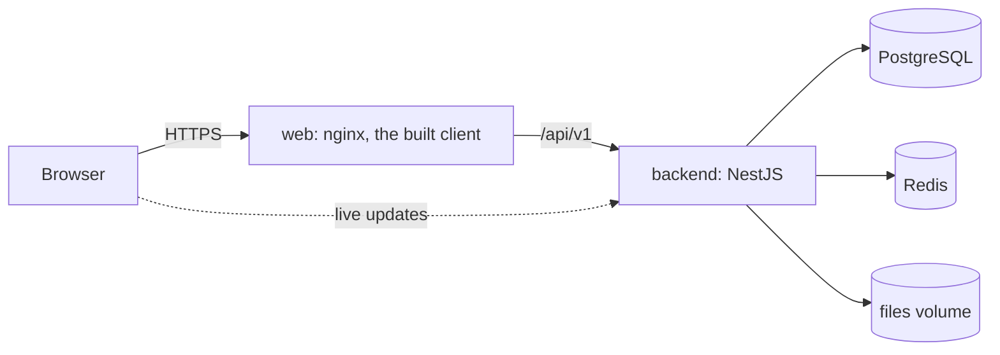

# How TrustBazaar is built

This is the map. It tells you what the parts are, how they fit and where to look, in the order you need it. The rules that every task follows are in [BUILDING.md](BUILDING.md); how to do a particular change is in [docs/HOW-TO.md](docs/HOW-TO.md); the requirements are in `docs/srs.tex` and the per-unit design is in `docs/design/`.

TrustBazaar is a marketplace where the money stays safe until the buyer has the item. A buyer pays into escrow, the seller hands over, and only then is the seller paid; if something goes wrong a dispute decides. It has fixed-price listings and auctions, meetup and courier delivery, game-account sales, chat, and a staff console.

## The parts



| Part | What it is | Where |
|---|---|---|
| **web** | nginx serving the built client; it sends `/api/v1` to the backend | `docs/design/deploy/web.Dockerfile`, `frontend/` |
| **backend** | one NestJS process: the HTTP API, the live connection, the scheduled jobs | `backend/` |
| **PostgreSQL** | all durable data, one schema per backend unit; the schema is changed only by migrations | `backend/src/migrations/`, `docs/design/sql/` |
| **Redis** | short-lived state: sign-in throttles, one-time tickets, idempotency keys, live fan-out | `backend/src/kernel/redis.provider.ts` |
| **files** | uploaded photos and documents, private, served only through signed links | `backend/src/modules/*/` (media) |

The database has two accounts: `tb_owner` runs the migrations and owns the schemas; `tb_app` is the application's account and cannot change the schema (SEC-INF-03).

## The backend

One kernel and seven **units**. Each unit is a NestJS module with a fixed internal shape:

```
backend/src/
  kernel/         what every unit needs and none owns: config, the event bus and outbox, the problem
                  documents, policies (who may call a route), idempotency, health, metrics, the database pool
  modules/
    identity/     accounts, sign-in, sessions, KYC, staff accounts, approvals, audit
    listings/     listings, search, auctions (bids, closing, second chance), stock
    orders/       orders, escrow, the ledger, payments, refunds, payouts, subscriptions and featuring
    delivery/     meetup handover, courier shipments, delivery areas and addresses
    game-accounts game-account listings and the sealed credential handover
    chat/         conversations, notifications, the message screen
    trust/        disputes, ratings, strikes and sanctions, reports, privacy, the parameter set and staff tools
  <unit>/
    http/         controllers and DTOs: the routes and the shape of a request
    services/     the rules: what may happen, in which order, in which transaction
    db/           entities (the schema as TypeORM sees it)
    ports/        the unit's public face: what other units may call
    adapters/     how this unit reaches the others' ports, and outside services (providers, couriers)
    consumers/    handlers of other units' events
    jobs/         scheduled work
```

**The one rule that holds it together (DC-1):** a unit never reads or writes another unit's tables and never imports another unit's files. It asks the other unit's **port**. ESLint (`.eslintrc.js`) and `src/import-boundaries.spec.ts` enforce it, and the kernel never imports a unit. When two units must change something together, the call goes through the port **in the caller's transaction** (DC-13). The full list of design rules, DC-1 to DC-15, is in [BUILDING.md](BUILDING.md) section 4.

### How things talk

- **A request** reaches a controller; its **policy decorator** (`@Public`, `@SignedIn`, `@Verified`, `@Staff` or a credential) says who may call it, and a route without one cannot be reached (DC-7). The DTO class validates the body. The controller calls a service; the service does the work in a transaction and answers. Every refusal is an RFC 9457 problem document (`kernel/http/problems.ts`).
- **An event** is written to the unit's outbox **in the same transaction** as the change (DC-6), and the outbox dispatcher hands it to the units that subscribed (`bus.on('orders.order.paid', 'listings.stock', ...)`). Event names are `<unit>.<entity>.<past tense>`; consumers are idempotent.
- **A business parameter** (a limit, a window, a fee) is a `CP-nn` value read through `ConfigPort`, never written in code (NFR-MNT-06). Staff change them through a four-eyes approval; an order or auction keeps the version it was created with.
- **Money** is an integer number of poisha (`bigint`), never a float. **Time** is `timestamptz` in UTC; the Dhaka clock is only on the screen.
- **A transaction holds a database connection for its whole length.** Inside one, use the transaction's own manager for every query; anything that needs another pool connection while the transaction waits for a lock can starve the pool. `kernel/db/pool-watch.ts` reports it, and `DB_POOL_MAX` and `DB_CONNECT_TIMEOUT_MS` bound it.

The API as built is documented in [docs/api/openapi.json](docs/api/openapi.json), generated from the code ([docs/api/README.md](docs/api/README.md)).

## The frontend

A React and Vite client in `frontend/`. It is built into **separate documents**, so a page that handles something sensitive loads none of the rest:

| Document | Entry | What it holds |
|---|---|---|
| the user app | `src/entries/app.tsx` | everything a member sees |
| the ID check | `src/entries/kyc.tsx` | the KYC wizard |
| the staff console | `src/entries/staff.tsx` | operator and administrator screens |
| the credential document | `src/secure/` | the sealed handover page; it loads no shared code and repeats the design's tokens in its own stylesheet (SEC-GAM-03) |

```
frontend/src/
  features/<area>/  one folder per area of the app (account, chat, checkout, kyc, listings, notifications,
                    orders, privacy, search, seller): its pages, its routes.tsx, its tests, its stylesheet
  staff/            the console's pages
  shared/           what every area uses: the API client, the language layer, forms, the shell,
                    the session and step-up, tokens.css (the one source of colour, type, space and motion)
  shared/ui/        the design system: Button, Field, Panel, Stepper, Popup, Calendar and the rest, with stories
  messages/{en,bn}/ the words, one catalogue per area, in English and Bangla
  lib/              plain code with no React: money, time, the live connection
```

How a screen is made:

1. The area's `routes.tsx` is registered by the entry; the page is a lazy route.
2. The page asks the API through TanStack Query (`shared/api.ts`); it never builds a URL by hand.
3. What it says comes from the catalogues through `t('area.key')`; both languages must have the same keys (a test checks it).
4. What it is made of comes from `shared/ui`. A page chooses a **variant** of a component; it does not style a button, a field or a card of its own. A role's steps and words (the buyer's order and the seller's) are decided by a small view-model function, not by the markup.
5. Every colour, size, space, corner and duration is a token in `tokens.css`; Stylelint fails the build on a raw colour or font. Dark is the default theme and light is chosen by `<html data-theme>`.

The design itself (the line grid, the type, the components) is described in [DESIGN.md](DESIGN.md) and `docs/design/`; the components you can use are in Storybook (`npm run storybook`, in `frontend/`).

## How we know it works

| Check | What it proves | Where |
|---|---|---|
| Unit tests | the logic of a service or a screen; each test is named after the requirement it proves (`FR-AUC-04 ...`) | `backend/src`, `frontend/src` |
| Integration suite | the whole backend over HTTP with PostgreSQL and Redis, including the concurrency suites | `backend/test/` |
| Database tests | the design's SQL rules on a real database | `docs/design/sql/` |
| Screenshot tests | no screen changed by accident: 92 pictures compared with zero different pixels | `frontend/e2e/visual/` |
| Lint, format, Stylelint | one style; no raw colour; size and complexity limits | `.eslintrc.js`, `eslint.config.js`, `stylelint.config.mjs` |
| Dependency rules | the unit boundaries and `shared/ui` staying presentational | `.eslintrc.js`, `frontend/.dependency-cruiser.cjs` |
| The health ratchet | the counts of lint warnings, unused code and duplicated code may go down and never up | `scripts/health-ratchet.mjs`, `*/health-baseline.json` |
| OpenAPI check | the API document is the one the code generates | `backend/test/api/openapi.spec.ts` |

All of it runs in CI on every pull request (`.github/workflows/ci.yml`); a red check is a real finding, with one known exception noted in [docs/HOW-TO.md](docs/HOW-TO.md).

## Where the truth is

| Question | Look in |
|---|---|
| What must it do? | `docs/srs.tex` (requirement IDs: `FR-`, `NFR-`, `SEC-`, `IF-`) |
| How was it designed? | `docs/design/01_...pdf` to `09_...pdf` |
| What is built, by whom, and what was decided? | `PROGRESS.md` (the task table and the Decisions log) |
| How do I do a task here? | [BUILDING.md](BUILDING.md), [CONTRIBUTING.md](CONTRIBUTING.md), [docs/HOW-TO.md](docs/HOW-TO.md) |
| Why is it like this? | [docs/decisions/](docs/decisions/) and the Decisions log |
| What does an area contain? | the `README.md` in each folder of `frontend/src/features/` and `backend/src/modules/` |
